# Forecasting della qualità dell'aria giornaliera in Campania – come funziona e cosa abbiamo imparato

Questo documento spiega, passo per passo, come è stato fatto il forecasting giornaliero degli inquinanti con **ARIMA, SARIMAX, Prophet e XGBoost**. Descrive come funziona ciascun metodo, come sono stati impostati e valutati i modelli e cosa mostrano i risultati (grafici inclusi).

Il **PM10** è il caso di studio dettagliato (§1–10): è il principale problema di qualità dell'aria della regione, e su di esso si spiegano i metodi. La stessa pipeline è poi applicata a **PM2.5, NO2, O3, SO2, CO e benzene** (§11). Il §12 estende tutto a una **previsione fino a sette giorni** e riporta la previsione per la settimana successiva all'ultimo dato.

Le tabelle numeriche complete sono in [forecast_results.md](forecast_results.md). Tutto il codice è in un unico file, [air_quality_forecast.py](codice/air_quality_forecast.py).

---

## Indice

1. [Il problema di forecasting](#1-il-problema-di-forecasting)
2. [Preparazione dei dati](#2-preparazione-dei-dati)
3. [Come vengono valutati i modelli](#3-come-vengono-valutati-i-modelli)
4. [Baseline](#4-baseline)
5. [ARIMA](#5-arima)
6. [SARIMAX](#6-sarimax)
7. [Prophet](#7-prophet)
8. [XGBoost](#8-xgboost)
9. [Risultati per il PM10](#9-risultati-per-il-pm10)
10. [Perché tutti i modelli sbagliano i giorni più inquinati](#10-perché-tutti-i-modelli-sbagliano-i-giorni-più-inquinati)
11. [Gli altri inquinanti](#11-gli-altri-inquinanti)
12. [Previsione a sette giorni](#12-previsione-a-sette-giorni)
13. [Conclusioni e prossimi passi](#13-conclusioni-e-prossimi-passi)
14. [Come riprodurre i risultati](#14-come-riprodurre-i-risultati)

---

## 1. Il problema di forecasting

| Scelta | Valore | Perché |
|---|---|---|
| **Target** | Media giornaliera di PM10 (µg/m³) | Il PM10 è il principale problema di qualità dell'aria nella regione, e il limite di legge (50 µg/m³ giornalieri, massimo 35 giorni l'anno) è definito sulle medie giornaliere |
| **Orizzonte** | 1 giorno avanti; da 1 a 7 giorni nel §12 | "Quanto sarà il PM10 domani?" è la domanda operativa più comune (allerte, misure sul traffico) |
| **Stazioni** | Acerra ZI, San Vitaliano, Napoli Ferrovia, Avellino Alighieri | Due delle stazioni più inquinate della regione, una stazione urbana da traffico, una stazione pulita come confronto |
| **Periodo di training** | 20/03/2023 – 31/12/2025 | Tutto ciò che precede il periodo di test |
| **Periodo di test** | 01/01/2026 – 26/10/2026 | Circa 10 mesi che i modelli non hanno mai visto durante il training |

Per gli altri inquinanti orizzonte, periodi e modelli sono gli stessi. Cambiano il target (per l'O3 si usa il massimo giornaliero della media mobile su 8 ore), la soglia dei superamenti e, dove una stazione non misura l'inquinante, le stazioni di valutazione. I dettagli sono nel §11.1.

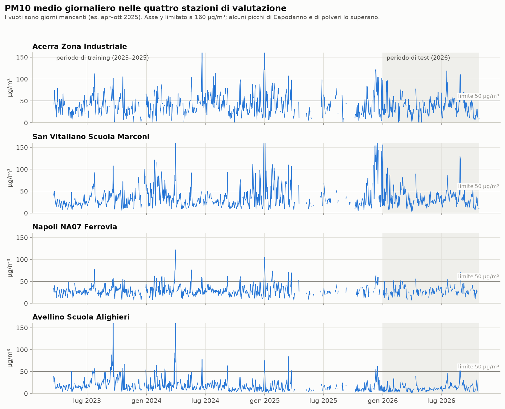

*Figura 1 – Le quattro serie. Il periodo di test 2026 è ombreggiato. Ci sono vuoti evidenti, in particolare aprile–ottobre 2025, oltre a singoli giorni mancanti. Le stazioni inquinate (Acerra, San Vitaliano) superano spesso la linea dei 50 µg/m³. Avellino quasi mai.*

---

## 2. Preparazione dei dati

([air_quality_forecast.py](codice/air_quality_forecast.py), sezione 1)

1. **Pulizia dei dati orari**, con le stesse regole dell'analisi descrittiva:
   - vengono rimossi il codice di valore mancante `-9999` e i valori negativi;
   - vengono rimossi i valori fisicamente impossibili;
   - vengono rimossi i sensori "bloccati" (lo stesso valore estremo per almeno 6 ore);
   - vengono rimosse le serie stazione × inquinante × anno interamente a zero.
2. **Media giornaliera**: un giorno è valido solo se almeno 18 delle sue 24 ore sono valide. È la regola del 75% usata nella normativa italiana (D.Lgs. 155/2010). I giorni con meno ore valide sono **mancanti (NaN)**, non vengono riempiti.
3. **Massimo giornaliero della media mobile su 8 ore per l'O3 (MDA8)**: per ogni ora si calcola la media delle 8 ore precedenti (valida se almeno 6 ore su 8 sono valide). Il massimo del giorno è valido se almeno 18 delle 24 medie sono valide. È l'indicatore su cui è definito il valore obiettivo dell'O3 (120 µg/m³).
4. **Trasformazione logaritmica**: tutti i modelli lavorano su `log(1 + valore)` e la previsione viene riconvertita con `exp(x) − 1`. I motivi sono due:
   - Le concentrazioni hanno una forte asimmetria a destra: molti giorni ordinari e pochi giorni molto alti. Su scala logaritmica la distribuzione è approssimativamente simmetrica, che è ciò che ARIMA e Prophet assumono.
   - La previsione non può mai essere negativa.

   La trasformazione logaritmica ha anche un costo, discusso nel §10.

**Giorni mancanti.** Ogni modello li gestisce a modo suo:

| Modello | Come gestisce i giorni mancanti |
|---|---|
| ARIMA / SARIMAX | Nativamente, tramite il Kalman filter: un giorno mancante è semplicemente "non osservato", e il modello continua a prevedere attraverso il vuoto |
| Prophet | I giorni mancanti vengono scartati; Prophet non ha bisogno di una serie regolare |
| XGBoost | Le feature di lag diventano NaN; XGBoost impara una direzione di default per i valori mancanti a ogni split |

---

## 3. Come vengono valutati i modelli

### One-step-ahead, con parametri fissi

Ogni modello viene **stimato una sola volta** sul periodo di training. Poi, per ogni giorno di test *t*, prevede *t* usando tutto ciò che è stato osservato fino al giorno *t − 1*. I parametri del modello **non vengono ristimati** durante il test. Il modello si limita a "leggere" le nuove osservazioni man mano che arrivano.

Questo simula un contesto operativo, in cui ogni sera si prevede il giorno dopo. È anche equo: nessun modello vede mai il giorno che sta prevedendo.

### Gli stessi giorni per tutti i modelli

Le metriche sono calcolate solo sui giorni-stazione in cui l'osservazione è valida e tutti i modelli hanno prodotto una previsione. In questo modo nessun modello è avvantaggiato dall'essere valutato su giorni "più facili". Per il PM10 sono **1.038 giorni-stazione**, tra cui **105 giorni sopra i 50 µg/m³**.

### Metriche

| Metrica | Cosa misura | Come leggerla |
|---|---|---|
| **MAE** (mean absolute error) | Ampiezza media dell'errore, nell'unità dell'inquinante | Metrica principale. "In media la previsione sbaglia di X µg/m³" |
| **RMSE** (root mean squared error) | Come il MAE, ma gli errori grandi pesano di più | Un RMSE alto rispetto al MAE indica errori grandi occasionali |
| **Bias** | Media di (previsto − osservato) | Negativo = il modello prevede in media troppo basso |
| **Skill vs persistenza** | `1 − MAE_modello / MAE_persistenza` | Quanto è meglio di "domani = oggi". 0 % = non è meglio; negativo = è peggio. È l'unica metrica confrontabile tra inquinanti diversi, perché non dipende dall'unità di misura |
| **Precision (superamenti)** | Dei giorni in cui il modello ha previsto un valore sopra la soglia, quanti erano davvero sopra | Alta = pochi falsi allarmi |
| **Recall (superamenti)** | Dei giorni che erano davvero sopra la soglia, quanti il modello ha previsto sopra | Alta = pochi episodi mancati |
| **F1** | Media armonica di precision e recall | Un unico numero che riassume entrambe |

Quando un modello non prevede mai un superamento, la precision non è calcolabile e nelle tabelle compare "–".

**Perché non il MAPE?** Gli errori percentuali esplodono nei giorni puliti con valori vicini a zero, quindi il MAPE sarebbe dominato dai giorni meno importanti.

---

## 4. Baseline

Un modello è utile solo se batte qualcosa di banale. Si usano due baseline:

- **Persistenza**: domani = oggi (l'ultimo valore osservato). Per la qualità dell'aria è sorprendentemente difficile da battere, perché gli episodi di inquinamento durano diversi giorni.
- **Seasonal naive (t − 7)**: domani = lo stesso giorno della settimana precedente. Verifica se il solo ciclo settimanale ha valore predittivo. Per il PM10 è molto peggiore (MAE 13,9 contro 8,6), il che ci dice che **l'andamento settimanale è debole rispetto alla persistenza da un giorno all'altro**.

---

## 5. ARIMA

### L'idea

ARIMA(p, d, q) spiega il valore di oggi con tre ingredienti:

- **AR(p) – autoregressivo**: oggi dipende dai *p* giorni precedenti.
  `y_t = c + φ₁·y_{t−1} + … + φ_p·y_{t−p} + ε_t`
- **I(d) – integrato**: la serie viene differenziata *d* volte (`y_t − y_{t−1}`) per rimuovere i trend. Se `d = 0`, la serie oscilla attorno a una media stabile.
- **MA(q) – moving average**: oggi dipende anche dagli ultimi *q* errori di previsione (`θ₁·ε_{t−1} + …`). Questo permette al modello di correggersi quando ha sbagliato di recente.

### Leggere i dati: ACF e PACF

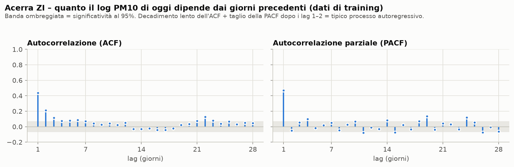

*Figura 2 – Autocorrelazione (sinistra) e autocorrelazione parziale (destra) del log PM10 ad Acerra, dati di training.*

- L'**ACF** (correlazione tra oggi e *k* giorni prima) vale 0,44 al lag 1 e 0,21 al lag 2, poi decade lentamente verso zero. Ieri conta molto, l'altro ieri un po', e la memoria svanisce nel giro di circa una settimana.
- La **PACF** (correlazione al lag *k* dopo aver rimosso l'effetto dei lag più brevi) ha un unico picco forte al lag 1 (0,47) e quasi nulla dopo. È la firma di un **processo di tipo AR(1)**. La maggior parte di ciò che il passato ci dice sta nel valore di ieri.
- I picchi ai **lag 7, 14, 21** sono piccoli. Il ciclo settimanale esiste ma è debole, in linea con lo scarso risultato della baseline seasonal naive.

### Scelta dell'ordine

Invece di leggere gli ordini a occhio dai grafici, lo script prova ogni combinazione **p ∈ {0..3}, d ∈ {0, 1}, q ∈ {0..3}** (32 modelli per stazione). Tiene quello con l'**AIC** (Akaike Information Criterion) più basso, che premia la bontà di adattamento e penalizza la complessità.

| Stazione | ARIMA selezionato (PM10) |
|---|---|
| Acerra ZI | ARIMA(1, 0, 3) |
| San Vitaliano | ARIMA(2, 0, 2) |
| Napoli Ferrovia | ARIMA(1, 0, 1) |
| Avellino | ARIMA(1, 1, 3) |

`d = 0` in tre stazioni su quattro conferma che in questo periodo il PM10 non ha un trend che richieda differenziazione. Oscilla attorno a un livello stabile. Gli ordini selezionati per gli altri inquinanti sono in [forecast_results.md](forecast_results.md).

### Limiti dell'ARIMA semplice

ARIMA conosce solo il passato recente della serie stessa. Non ha alcuna nozione di stagione, giorno della settimana, festività o meteo. In inverno "impara" che l'inquinamento è alto solo dopo aver osservato qualche giorno alto.

---

## 6. SARIMAX

**SARIMAX** = **S**easonal **ARIMA** con variabili e**X**ogene. Aggiunge due cose all'ARIMA.

### (a) Una componente ARIMA stagionale – (P, D, Q, s)

La stessa logica AR / differenziazione / MA, applicata al lag *s* invece che al lag 1. Con `s = 7` il modello può dire "oggi dipende anche dallo stesso giorno della settimana scorsa". Lo script confronta 12 combinazioni (4 ordini non stagionali × 3 stagionali) e tiene quella con l'AIC più basso. Per il PM10 il modello selezionato in tre stazioni è stato **SARIMAX(1,0,1)×(1,0,1,7)**: un termine AR e uno MA al lag 1, più un termine AR e uno MA al lag 7. Ad Avellino è stato scelto **SARIMAX(2,1,2)×(1,0,1,7)**, con una differenziazione, coerente con l'ARIMA(1,1,3) della stessa stazione.

### (b) Regressori esogeni

Sono variabili esterne note in anticipo, che entrano nell'equazione come in una regressione lineare:

- **Termini di Fourier per il ciclo annuale**: `sin(2πk·t/365.25)` e `cos(2πk·t/365.25)` per k = 1, 2. Queste quattro onde regolari permettono al modello di dare forma a un andamento inverno/estate.
- **Flag festività**: festività nazionali italiane più il 31 dicembre (fuochi d'artificio).

**Perché termini di Fourier invece di `s = 365`?** Un ARIMA stagionale con una stagione di 365 giorni richiede centinaia di stati ritardati. È estremamente lento e instabile, e con solo circa 2,8 anni di dati di training vedrebbe meno di 3 cicli. I termini di Fourier descrivono la forma annuale con soli 4 parametri.

### Risultato

Per il PM10 SARIMAX migliora ARIMA solo marginalmente (MAE 7,97 contro 8,02). A un **orizzonte di 1 giorno**, il valore di ieri contiene già la stagione ("è inverno, quindi ieri era alto, quindi oggi sarà alto"). Ci si aspetterebbe che l'informazione stagionale aggiuntiva diventi più utile a orizzonti più lunghi (3–7 giorni), dove il passato recente dice meno. Il §12.2 mostra che anche a sette giorni il vantaggio su ARIMA resta piccolo.

---

## 7. Prophet

### L'idea

Prophet (sviluppato da Meta) non è un modello autoregressivo. È un modello di **curve fitting** che scompone la serie in componenti additive:

```
y(t) = trend(t) + yearly(t) + weekly(t) + holidays(t) + errore
```

- **trend**: una linea lineare a tratti che può cambiare pendenza in punti individuati automaticamente;
- **yearly / weekly**: curve periodiche regolari (serie di Fourier);
- **holidays**: un effetto separato per ogni festività (qui, il calendario italiano).

Poiché modelliamo `log(valore)`, gli effetti additivi diventano **moltiplicativi** sulla concentrazione. "+0,2 su scala logaritmica" significa "circa il 22 % in più".

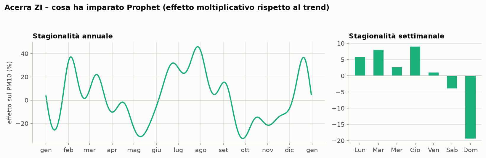

*Figura 3 – Cosa ha imparato Prophet ad Acerra, come effetto % sul PM10 rispetto al trend.*

- **Settimanale**: la domenica è circa il **19 % più bassa** e il sabato circa il 4 % più basso. I giorni feriali sono dell'1–9 % più alti. È il segnale del traffico.
- **Annuale**: la curva è **molto ondulata**: picchi a febbraio, fine luglio / agosto (+45 %) e metà dicembre, minimi a maggio e ottobre (circa −30 %). In parte è reale (riscaldamento invernale, polveri estive), ma in buona parte è **overfitting**. Con meno di 3 anni di dati, la curva annuale flessibile di default di Prophet memorizza episodi specifici, come le polveri e gli incendi dell'estate 2024, come se si ripetessero ogni anno.
- **Festività**: Prophet ha imparato un forte effetto di Capodanno dai fuochi d'artificio presenti nei dati di training. Per questo ha previsto circa 150 µg/m³ a San Vitaliano il 1° gennaio 2026 (visibile all'inizio della Figura 5).

### Perché Prophet standard è andato male

La previsione di Prophet per una certa data **dipende solo dal calendario**, non da quello che è successo ieri. Se inizia un episodio di inquinamento, Prophet non può "vederlo". Continua a prevedere la media stagionale. Ecco perché, per il PM10, Prophet standard è **il 21 % peggio della persistenza**: perde tutta la dinamica da un giorno all'altro, che è dove si trova la maggior parte della prevedibilità. Per gli altri inquinanti va ancora peggio (§11.2).

### Prophet + lag

Prophet permette di aggiungere **regressori extra**. Aggiungendo l'ultimo valore osservato e la media degli ultimi 7 giorni (entrambi noti la sera del giorno *t − 1*) diventa un modello quasi autoregressivo. Con questi, per il PM10 Prophet diventa competitivo (MAE 8,01, il miglior RMSE con 13,04). A quel punto si comporta come una regressione lineare sui valori recenti più una stagionalità regolare.

**Lezione:** Prophet è bravo a descrivere stagionalità e festività, ma da solo non è uno strumento di forecasting a breve termine per una serie guidata dalla persistenza.

---

## 8. XGBoost

### L'idea

XGBoost non è un modello per serie temporali. È un modello di **gradient-boosted decision tree** per la regressione ordinaria. Per usarlo nel forecasting, il problema viene trasformato in una tabella: **una riga per giorno-stazione**, con il target (`log` della concentrazione di quel giorno) e **feature costruite solo con le informazioni disponibili la sera prima**.

Il boosting costruisce gli alberi uno dopo l'altro. Ogni nuovo albero corregge gli errori della somma dei precedenti. Gli alberi possono catturare **effetti non lineari e interazioni** (per esempio "ieri era alto *e* siamo in inverno *e* la media regionale sta salendo"), cosa che ARIMA non può fare.

### Feature utilizzate

| Gruppo | Feature |
|---|---|
| Valori recenti del target nella stazione | valore di 1, 2, 3, 7 e 14 giorni prima; ultimo valore osservato (portato avanti sui giorni mancanti); medie a 7 e 30 giorni |
| Altri inquinanti di ieri | PM10, PM2.5, NO2 e O3 della stessa stazione, escluso il target (per il PM10: PM2.5, NO2, O3) |
| Segnale regionale | media del target su tutte le stazioni 1 e 2 giorni prima (cattura episodi a scala regionale come le polveri sahariane) |
| Calendario | giorno della settimana, giorno dell'anno (sin/cos), mese, flag festività |
| Stazione | codice stazione (categorico), così un solo modello può imparare livelli specifici per stazione |

### Un unico modello globale per inquinante

Invece di un modello per stazione, per ogni inquinante XGBoost viene addestrato **una sola volta su tutte le stazioni fisse che lo misurano**. Per il PM10 sono 35 stazioni, quindi circa 26.500 righe di training invece di circa 800. Il modello può imparare comportamenti generali, come "come evolve il PM10 dopo un giorno alto", dall'intera rete, e poi specializzarsi per stazione.

### Evitare l'overfitting

Gli ultimi 90 giorni del periodo di training vengono tenuti da parte per trovare il numero giusto di alberi (**early stopping**). Per il PM10 il training si è fermato a **108 alberi**. Il modello finale viene poi ristimato sull'intero training set con quel numero.

### Cosa guida la previsione

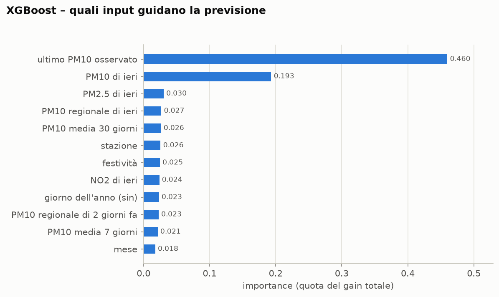

*Figura 4 – Quota del "gain" totale (riduzione dell'errore) apportata da ciascuna feature, modello PM10.*

Circa il **65 %** del potere predittivo viene da due feature: l'**ultimo PM10 osservato** e il **PM10 di ieri**. (Esistono entrambe perché "ieri" a volte manca, e allora è l'ultimo valore osservato a portare l'informazione.) Tutto il resto contribuisce per il 2–3 % ciascuno:
- PM2.5 di ieri;
- PM10 regionale;
- il livello a 30 giorni;
- la stazione;
- le festività;
- NO2 di ieri;
- la posizione stagionale.

È lo stesso messaggio del grafico dell'ACF: **con i soli dati storici di qualità dell'aria, la previsione è essenzialmente "ieri, corretto"**. Il §11.4 mostra che vale per tutti gli inquinanti.

---

## 9. Risultati per il PM10

### Complessivi (4 stazioni, 1.038 giorni di test)

| Modello | MAE | RMSE | Bias | Precision | Recall | F1 | Skill vs persistenza |
|---|---:|---:|---:|---:|---:|---:|---:|
| **XGBoost** | **7,91** | 13,25 | −2,22 | **0,72** | 0,22 | 0,34 | **+7,7 %** |
| **SARIMAX** | 7,97 | 13,61 | −1,47 | 0,71 | 0,29 | 0,41 | +7,0 % |
| **Prophet + lag** | 8,01 | **13,04** | −2,14 | 0,62 | 0,25 | 0,35 | +6,5 % |
| **ARIMA** | 8,02 | 13,73 | −1,70 | 0,65 | 0,23 | 0,34 | +6,4 % |
| Persistenza | 8,57 | 15,01 | +0,04 | 0,55 | **0,55** | **0,55** | 0 % |
| **Prophet** | 10,37 | 15,43 | −1,92 | 0,25 | 0,06 | 0,09 | −21,1 % |
| Seasonal naive (t − 7) | 13,93 | 20,98 | +0,41 | 0,24 | 0,25 | 0,24 | −62,6 % |

Precision, recall e F1 si riferiscono ai giorni con PM10 > 50 µg/m³. La persistenza ha il MAE peggiore tra i modelli "seri", ma l'**F1 migliore** (0,55 contro 0,34–0,41). Il motivo è spiegato nel §10.

### Previsioni sul periodo di test

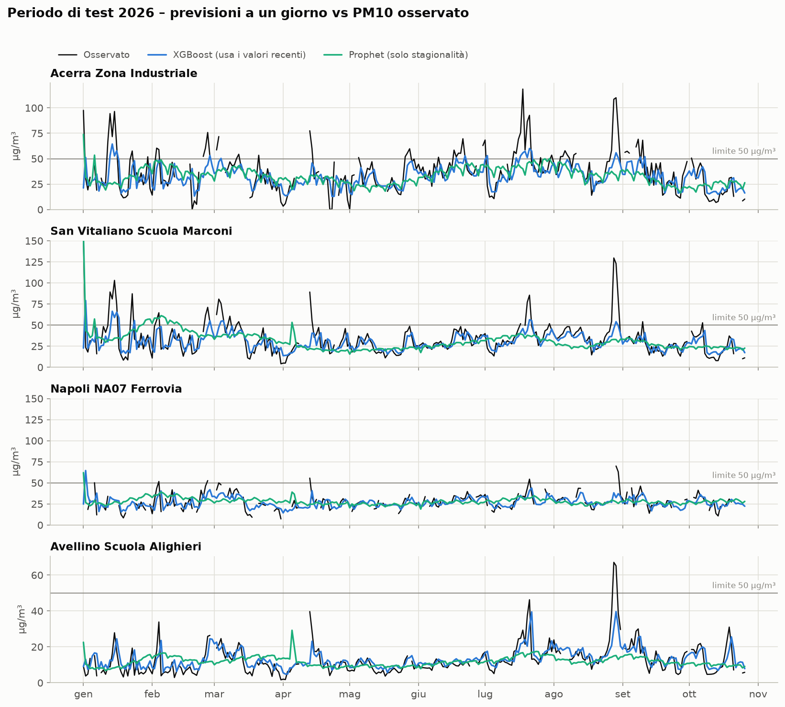

*Figura 5 – PM10 osservato (nero), XGBoost (blu) e Prophet standard (verde) sul periodo di test 2026.*

- **XGBoost segue i saliscendi da un giorno all'altro**, perché è guidato dal valore di ieri. Riproduce bene anche il livello generale in tutte le stazioni.
- **Prophet è una curva stagionale regolare.** Azzecca il livello generale, ma non reagisce agli episodi (es. Acerra e San Vitaliano a fine agosto). Ha lo strano picco di Capodanno il 1° gennaio.
- **I picchi più alti sono sottostimati da entrambi i modelli**: fine luglio e fine agosto ad Acerra e San Vitaliano, e fine agosto ad Avellino. Se ne parla nel §10.

### Uno sguardo più da vicino: Acerra, gennaio–marzo 2026

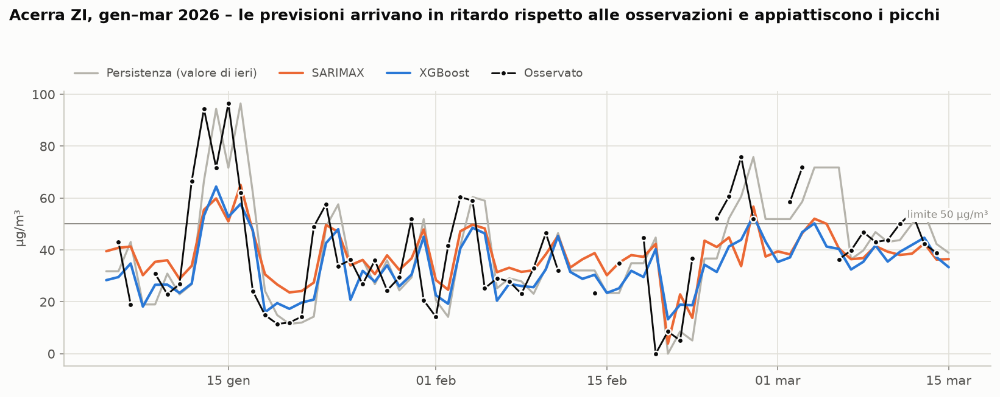

*Figura 6 – Valori osservati (punti neri) vs persistenza (grigio), SARIMAX (arancione) e XGBoost (blu).*

Questo zoom mostra il comportamento tipico di una previsione a 1 giorno basata sui valori passati:
- **Le previsioni sono in ritardo di un giorno.** Quando il PM10 salta da 25 a 95 µg/m³ (metà gennaio), i modelli salgono solo il giorno *dopo*. Non hanno modo di sapere che il salto sta per arrivare.
- **I modelli "restringono" la previsione della persistenza verso la media.** Dopo un giorno alto, la persistenza ripete il valore alto; SARIMAX e XGBoost prevedono qualcosa di intermedio. Questo riduce l'errore medio, perché molti giorni alti sono seguiti da giorni più bassi. Ma significa anche che i modelli prevedono raramente sopra 50.

### Per stazione

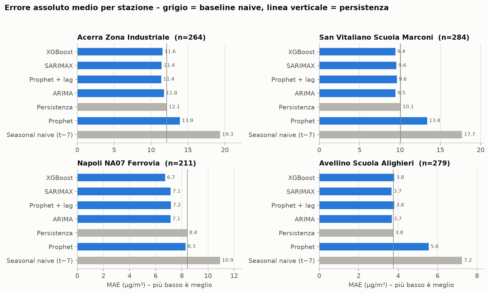

*Figura 7 – MAE per modello e stazione. Le barre grigie sono le baseline naive; la linea verticale indica la persistenza.*

| Stazione | Giorni di test | Giorni > 50 | MAE persistenza | Miglior modello (MAE) | Skill | Recall persistenza | Miglior recall di un modello |
|---|---:|---:|---:|---|---:|---:|---:|
| Napoli Ferrovia | 211 | 10 | 8,42 | XGBoost (6,73) | +20,1 % | 0,20 | 0,10 (Prophet); gli altri 0 |
| Acerra ZI | 264 | 62 | 12,13 | Prophet + lag (11,38) | +6,2 % | 0,63 | 0,24 (SARIMAX, XGBoost) |
| San Vitaliano | 284 | 31 | 10,08 | XGBoost (9,43) | +6,4 % | 0,52 | 0,48 (SARIMAX) |
| Avellino | 279 | 2 | 3,76 | SARIMAX (3,68) | +2,1 % | 0,50 | 0 |

- Gli errori crescono con il livello di inquinamento: il MAE è circa 11–12 µg/m³ ad Acerra e circa 3,7 ad Avellino.
- A **Napoli Ferrovia** XGBoost batte la persistenza del 20 %, il miglior risultato tra le quattro stazioni. Però ARIMA, SARIMAX, XGBoost e Prophet + lag **non intercettano nessuno** dei 10 superamenti.
- A **San Vitaliano** SARIMAX è l'unico caso in cui un modello batte la persistenza anche sui superamenti (F1 0,57 contro 0,52).
- Ad **Avellino** (un sito pulito) nessun modello batte la persistenza in modo significativo. C'è poco segnale da un giorno all'altro da sfruttare. Con soli 2 superamenti, precision e recall lì non hanno significato.
- La **classifica tra ARIMA, SARIMAX, XGBoost e Prophet + lag cambia da stazione a stazione**. Le loro differenze (pochi decimi di µg/m³) rientrano nel rumore di un test di 10 mesi. Vanno considerati **equivalenti**.

---

## 10. Perché tutti i modelli sbagliano i giorni più inquinati

È il risultato più importante per l'uso pratico. Vale per il PM10 e, come mostra il §11.3, anche per gli altri inquinanti con superamenti.

### Le evidenze

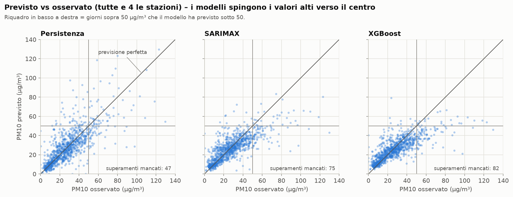

*Figura 8 – Ogni punto è un giorno-stazione. I punti sulla diagonale sono previsioni perfette. Il riquadro in basso a destra contiene i giorni che erano sopra 50 µg/m³ ma sono stati previsti sotto 50.*

Dei 105 giorni sopra 50 µg/m³ nel test set:
- **la persistenza ne ha mancati 47**;
- **SARIMAX ne ha mancati 75**;
- **XGBoost ne ha mancati 82**.

Le nuvole di punti dei modelli sono visibilmente **più piatte della diagonale**: ai valori osservati alti corrispondono previsioni nella fascia 40–60.

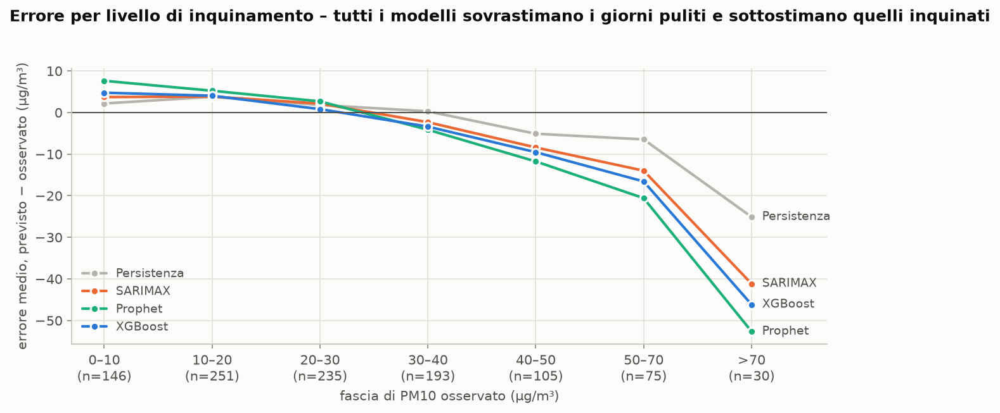

*Figura 9 – Errore medio raggruppato per livello di PM10 osservato.*

- Nei giorni puliti (0–20 µg/m³), tutti i modelli prevedono **troppo alto** (da +2 a +7 µg/m³).
- Nei giorni sopra 70 µg/m³, prevedono **molto troppo basso**:
  - la persistenza di circa 25 µg/m³;
  - SARIMAX di circa 41;
  - XGBoost di circa 46;
  - Prophet di circa 52.

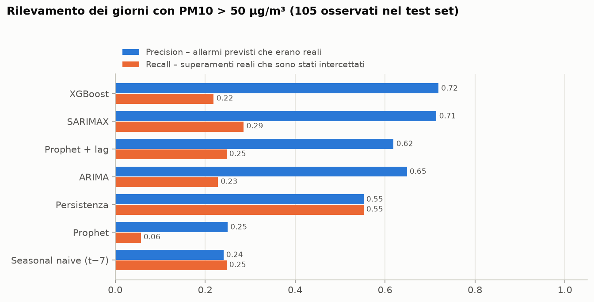

*Figura 10 – Rilevamento dei giorni sopra 50 µg/m³.*

I modelli hanno una **precision più alta** (quando prevedono un superamento di solito è reale: 62–72 %). Ma hanno una **recall molto più bassa** (intercettano solo il 22–29 % dei superamenti reali), mentre la persistenza ne intercetta il 55 %.

### Le cause

1. **Le previsioni che minimizzano l'errore vengono attirate verso la media (regression to the mean).** I modelli sono addestrati a minimizzare l'errore quadratico. Quando il futuro è incerto, la stima che minimizza l'errore è il valore *atteso*. Dopo un giorno alto, il PM10 a volte resta alto e a volte scende, quindi il valore atteso è più basso del valore di oggi. Il modello si "copre" correttamente, ed è proprio questa copertura che uccide la recall sui superamenti. La persistenza non si copre, ed è per questo che ha il MAE peggiore ma la recall migliore.

2. **La riconversione dalla scala logaritmica dà la mediana, non la media.** Se la previsione del modello su scala logaritmica è `m` con incertezza `σ`, allora `exp(m)` è la previsione *mediana* del PM10. La *media* è `exp(m + σ²/2)`, che è più alta. Poiché il PM10 è asimmetrico a destra, questo aggiunge un bias sistematico verso il basso che cresce con il livello. È il bias negativo che si vede nella tabella dei risultati.

3. **Manca l'informazione decisiva.** Gli episodi di inquinamento iniziano a causa del **meteo**: aria stagnante, strato limite basso, assenza di pioggia, trasporto di polveri sahariane, incendi. Niente di tutto questo è nel dataset. Senza queste informazioni, un modello può accorgersi di un episodio solo dopo che è iniziato (il ritardo di un giorno della Figura 6). È anche per questo che i quattro metodi finiscono così vicini tra loro: guardano tutti la stessa informazione limitata.

---

## 11. Gli altri inquinanti

La pipeline del PM10 è stata applicata, senza modifiche ai modelli, agli altri sei inquinanti del dataset. Per ciascuno si usano gli stessi modelli, le stesse griglie di ordini ARIMA/SARIMAX, la stessa trasformazione logaritmica, lo stesso protocollo one-step-ahead e un modello XGBoost globale dedicato. Rieseguito con il nuovo script, il PM10 dà risultati identici a quelli dei §1–10.

### 11.1 Impostazione

| Inquinante | Target | Soglia superamenti | Riferimento della soglia | Stazioni di valutazione |
|---|---|---|---|---|
| **PM2.5** | media giornaliera | 25 µg/m³ | limite giornaliero dal 2030 (Dir. UE 2024/2881) | Acerra ZI, San Vitaliano, Napoli Ferrovia, Avellino |
| **NO2** | media giornaliera | 50 µg/m³ | limite giornaliero dal 2030 (Dir. UE 2024/2881) | Acerra ZI, San Vitaliano, Napoli Ferrovia, Avellino |
| **O3** | massimo giornaliero della media mobile su 8 ore (MDA8) | 120 µg/m³ | valore obiettivo (D.Lgs. 155/2010) | Ariano Irpino, Napoli Parco Virgiliano, San Vitaliano, Volla |
| **SO2** | media giornaliera | 50 µg/m³ | limite giornaliero dal 2030 (Dir. UE 2024/2881) | Acerra ZI, San Vitaliano, Napoli Ferrovia, Polla |
| **CO** | media giornaliera | 4 mg/m³ | limite giornaliero dal 2030 (Dir. UE 2024/2881) | Acerra ZI, Napoli NA06 Museo, Napoli Ferrovia, Avellino |
| **Benzene (C6H6)** | media giornaliera | nessuna | esiste solo un limite annuale (5 µg/m³) | Acerra ZI, San Vitaliano, Napoli Ferrovia, Avellino |

**Le stazioni.** Dove possibile si usano le stesse quattro stazioni del PM10, così i risultati sono confrontabili tra inquinanti. Quando una stazione non misura l'inquinante, viene sostituita da una con lo stesso ruolo:
- **O3**: delle quattro stazioni del PM10 solo San Vitaliano misura l'ozono. L'O3 è un inquinante secondario: si forma al sole a partire da altri inquinanti e raggiunge i valori più alti lontano dalle sorgenti, nelle aree suburbane e collinari. Le altre tre stazioni sono quindi le due più colpite nel 2024 (**Ariano Irpino**, 74 giorni sopra 120, e **Parco Virgiliano**, 43) e **Volla**, la stazione con l'ozono medio più basso. Lì le emissioni locali di NO consumano l'ozono.
- **SO2**: Avellino non lo misura ed è sostituita da **Polla**, il sito più pulito.
- **CO**: San Vitaliano non lo misura ed è sostituita da **Napoli NA06 Museo**, una delle stazioni con il CO più alto.

**Le soglie.** Per PM2.5 e NO2 la normativa in vigore non prevede un limite giornaliero (per il PM2.5 c'è solo quello annuale; per l'NO2 quelli orario e annuale). Si usano quindi i limiti giornalieri che entreranno in vigore nel 2030. Per SO2 e CO le concentrazioni sono così basse che nel test **non c'è nessun superamento**, nemmeno delle soglie 2030: per questi due inquinanti le metriche sui superamenti non sono calcolabili.

**Perché il massimo su 8 ore per l'O3.** L'ozono ha un ciclo giornaliero molto marcato: alto nel pomeriggio, basso di notte. La media giornaliera diluisce proprio il picco che conta per la salute e per la normativa.

### 11.2 Quanto si riesce a prevedere

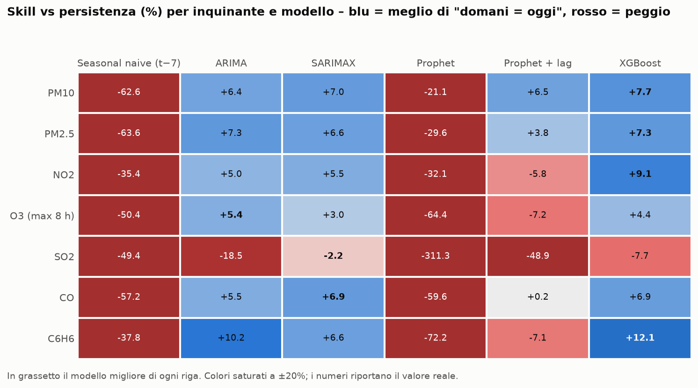

*Figura 11 – Skill vs persistenza per ogni inquinante (4 stazioni aggregate) e modello. Blu = meglio di "domani = oggi", rosso = peggio. In grassetto il modello migliore di ogni riga.*

| Inquinante | Giorni-stazione | Media osservata | MAE persistenza | Miglior modello | Skill del miglior modello | Prophet standard |
|---|---:|---:|---:|---|---:|---:|
| PM10 | 1.038 | 27,9 µg/m³ | 8,57 | XGBoost | +7,7 % | −21,1 % |
| PM2.5 | 1.025 | 13,8 µg/m³ | 4,55 | XGBoost / ARIMA | +7,3 % | −29,6 % |
| NO2 | 1.087 | 34,2 µg/m³ | 7,70 | XGBoost | +9,1 % | −32,1 % |
| O3 (MDA8) | 1.018 | 87,6 µg/m³ | 9,90 | ARIMA | +5,4 % | −64,4 % |
| SO2 | 1.045 | 2,7 µg/m³ | 0,31 | nessuno (SARIMAX −2,2 %) | – | −311,3 % |
| CO | 1.064 | 0,57 mg/m³ | 0,122 | SARIMAX / XGBoost | +6,9 % | −59,6 % |
| Benzene | 997 | 0,83 µg/m³ | 0,33 | XGBoost | +12,1 % | −72,2 % |

Il quadro del PM10 si ripete quasi identico per tutti gli inquinanti:

- **La persistenza resta difficile da battere.** I modelli migliori fanno dal 5 al 12 % meglio di "domani = oggi". Per l'SO2 nessun modello ci riesce.
- **ARIMA, SARIMAX e XGBoost sono vicini tra loro.** Il migliore cambia da inquinante a inquinante, e di solito lo scarto tra i primi tre è di 1–3 punti di skill. Le eccezioni sono NO2 e benzene, dove XGBoost si stacca un po' di più.
- **Prophet standard è sempre molto peggiore della persistenza** (da −21 a −311 %), e per O3, SO2, CO e benzene fa peggio anche della seasonal naive. Prophet + lag è competitivo solo per PM10 e PM2.5.

Le differenze tra inquinanti dicono qualcosa sulla loro natura:

- **NO2 e benzene: la skill più alta (+9 e +12 %).** Sono inquinanti legati al traffico, con un ciclo settimanale più marcato: la seasonal naive (t − 7) è meno disastrosa che per gli altri (−35 e −38 %, contro −50/−64 %). XGBoost sfrutta il livello recente della stazione (medie a 7 e 30 giorni) e, in misura minore, il giorno della settimana, che ARIMA non vede.
- **O3: la skill più bassa tra gli inquinanti prevedibili (+3/+5 %).** L'MDA8 ha un ciclo stagionale fortissimo, ma le variazioni da un giorno all'altro dipendono da sole e temperatura, cioè dal meteo, che non è nel dataset. Prophet fa −64 %: la sua curva annuale sovra-adattata e il livello appreso negli anni di training non tornano nel 2026. Ad Ariano Irpino sovrastima (bias +8,8 µg/m³), mentre a San Vitaliano e Volla sottostima (bias −10 e −12). Nella Figura 12 si vede Prophet sopra le osservazioni per tutto giugno–luglio ad Ariano.
- **SO2: nessun modello batte la persistenza.** Le concentrazioni sono di 2–3 µg/m³, vicine al limite di rilevabilità, e le serie sono dominate da cambi di livello irregolari, non stagionali. Ad Acerra, per esempio, la media semestrale passa da 1,0 µg/m³ (primo semestre 2023) a 5,1 (secondo semestre 2026). È plausibile che si tratti in parte di derive strumentali. La persistenza segue questi gradini, mentre i modelli che tornano verso il livello del training (ARIMA con `d = 0`, Prophet) li sbagliano. Prophet, in più, estrapola trend e stagionalità che non esistono: −311 %.
- **CO e benzene: buona skill, poca utilità pratica.** Le concentrazioni sono molto lontane dai limiti (il CO giornaliero massimo nel test è circa la metà della soglia 2030 di 4 mg/m³, e il benzene ha solo un limite annuale). La previsione è tecnicamente riuscita, ma non serve per le allerte.

**Cambi di livello tra training e test.** Diverse serie hanno nel 2026 un livello diverso da quello degli anni di training. A Napoli Ferrovia, per esempio, l'NO2 è sceso (media 2024 52,8 µg/m³, media 2026 42,6 secondo l'analisi descrittiva). I modelli che ricordano il livello del training lo sovrastimano: bias +3,2 µg/m³ per ARIMA e SARIMAX, +7,5 per Prophet. XGBoost, che guarda la media degli ultimi 30 giorni, ha un bias di −0,75 ed è il migliore della stazione. È un motivo in più per cui la persistenza e i modelli ancorati ai valori recenti funzionano bene.

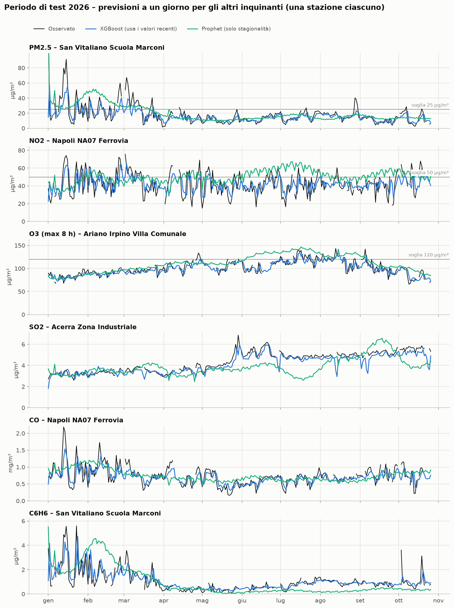

*Figura 12 – Periodo di test 2026: osservato (nero), XGBoost (blu) e Prophet standard (verde), una stazione per inquinante. La linea grigia è la soglia dei superamenti, quando le concentrazioni le si avvicinano.*

La Figura 12 mostra gli stessi comportamenti visti per il PM10: XGBoost insegue le osservazioni con un giorno di ritardo, Prophet disegna una curva stagionale. Si vedono anche i problemi specifici: per l'SO2 ad Acerra Prophet scende a luglio mentre l'osservato resta stabile intorno a 5 µg/m³, e per il benzene a San Vitaliano Prophet sovrastima a febbraio e sottostima per tutta l'estate, perché la curva annuale e il trend appresi sul 2023–2025 non corrispondono al 2026.

**Alcuni risultati per stazione** (tabelle complete in [forecast_results.md](forecast_results.md)):
- Napoli Ferrovia è la stazione dove i modelli guadagnano di più: PM10 +20 % (XGBoost), PM2.5 +18 % (SARIMAX), benzene +17 % (XGBoost), NO2 +10 % (XGBoost);
- NO2 ad Avellino: SARIMAX +16 %;
- CO a Napoli NA06 Museo: SARIMAX +15,5 %;
- SO2 ad Acerra e Polla, CO ad Acerra, PM2.5 ad Avellino: nessun modello batte davvero la persistenza.

### 11.3 I superamenti

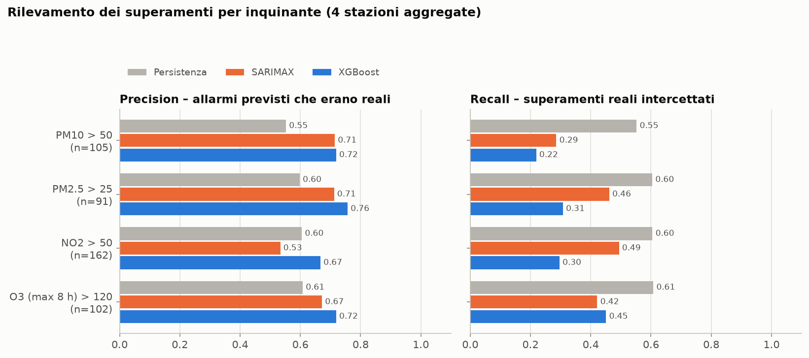

*Figura 13 – Precision e recall sui superamenti per gli inquinanti che ne hanno almeno 10 nel test (4 stazioni aggregate).*

| Inquinante (soglia) | Superamenti nel test | Persistenza: precision / recall / F1 | Miglior F1 tra i modelli |
|---|---:|---|---|
| PM10 (> 50) | 105 | 0,55 / 0,55 / 0,55 | 0,41 (SARIMAX) |
| PM2.5 (> 25) | 91 | 0,60 / 0,60 / 0,60 | 0,56 (SARIMAX, Prophet + lag) |
| NO2 (> 50) | 162 | 0,60 / 0,60 / 0,60 | 0,56 (ARIMA) |
| O3 MDA8 (> 120) | 102 | 0,61 / 0,61 / 0,61 | 0,56 (ARIMA) |

La conclusione del §10 vale per tutti: **i modelli hanno precision più alta ma recall più bassa della persistenza**, e la persistenza ha l'F1 migliore per ogni inquinante. Le cause sono le stesse (regression to the mean, riconversione dalla scala logaritmica, assenza del meteo).

Per PM2.5, NO2 e O3 il divario è però più piccolo che per il PM10: la recall di ARIMA e SARIMAX arriva a 0,42–0,49, contro 0,23–0,29 per il PM10. XGBoost, che si copre di più verso la media, resta più basso (0,30–0,45). Per questi inquinanti la soglia è più vicina ai livelli tipici. A Napoli Ferrovia, per esempio, l'NO2 è sopra 50 µg/m³ in 78 giorni su 269, e ad Ariano l'O3 è sopra 120 in 33 giorni su 262. Molti superamenti sono quindi giorni "ordinari" e non picchi estremi, e un modello che si copre verso la media li intercetta comunque.

Va detto anche che, con le soglie 2030, il numero di superamenti per PM2.5 e NO2 sarebbe già oggi un problema normativo: la direttiva ne ammetterà al massimo 18 all'anno per stazione.

### 11.4 Cosa guida la previsione

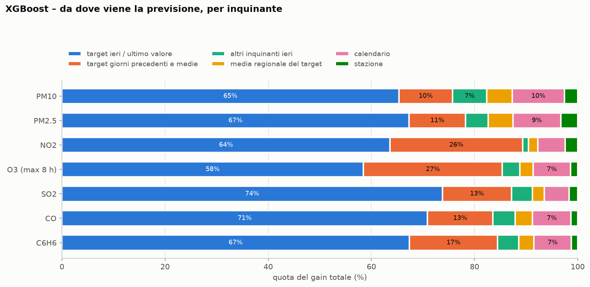

*Figura 14 – Quota del gain totale di XGBoost per gruppo di feature, per ogni inquinante.*

Per tutti gli inquinanti dal **75 al 90 %** del potere predittivo viene dai valori recenti del target stesso. Il valore di ieri e l'ultimo valore osservato pesano da soli il 58–74 %. Altri inquinanti, segnale regionale, calendario e stazione contribuiscono pochi punti ciascuno.

Le differenze sono nella **memoria**:
- per **NO2 e O3** circa un quarto del gain (26–27 %) viene dalle medie a 7 e 30 giorni e dai giorni precedenti. L'NO2 dipende dal livello tipico della stazione e dal traffico della settimana; l'O3 da un livello di fondo regionale che varia lentamente con la stagione;
- per gli altri inquinanti i giorni precedenti e le medie pesano solo il 10–17 %, e quasi tutto passa da ieri (65–74 %). Il caso estremo è l'SO2 (74 %): con serie che cambiano livello a gradini, ieri è la miglior stima del livello attuale.

Il messaggio è lo stesso del PM10: **senza dati meteo, la previsione di qualunque inquinante è "ieri, corretto"**.

---

## 12. Previsione a sette giorni

Fin qui la domanda era "quanto sarà domani?". Qui ci si chiede quanto si riesce a prevedere **fino a una settimana prima**. Ci sono due parti:
1. una valutazione su tutto il 2026 a orizzonti da 1 a 7 giorni;
2. una previsione vera per i 7 giorni dopo l'ultimo dato del dataset (27 ottobre – 2 novembre 2026).

### 12.1 Come si prevede a *h* giorni

L'**orizzonte *h*** è il numero di giorni tra l'ultimo dato usato e il giorno previsto. Prevedere il giorno *t* a *h* = 7 significa usare solo i dati fino a *t − 7*, come se la previsione fosse emessa una settimana prima. *h* = 1 è la previsione a un giorno dei §3–11. Valutazione, periodi e parametri restano quelli del §3: ogni modello è stimato una sola volta sul training e non viene ristimato durante il test.

| Modello | Come produce la previsione a *h* giorni |
|---|---|
| Persistenza | Ultimo valore noto al giorno *t − h* |
| Seasonal naive (t−7) | Valore del giorno *t − 7*, che è noto per ogni *h* ≤ 7. A *h* = 7 coincide quindi con la persistenza |
| ARIMA / SARIMAX | **Ricorsiva**: dal giorno di origine il modello prevede il giorno dopo, usa quella previsione come se fosse un dato, e così via per 7 passi. Stessi parametri della previsione a un giorno |
| Prophet | Nessun cambiamento: non usa i dati recenti, quindi prevede lo stesso valore a qualunque orizzonte |
| Prophet + lag, XGBoost | **Diretta**: un modello separato per ogni *h*, con tutte le feature spostate di *h* giorni. Per *h* = 7 XGBoost usa i valori di *t − 7*, *t − 8*, *t − 9* e *t − 14*, le medie a 7 e 30 giorni che finiscono a *t − 7* e gli altri inquinanti di *t − 7*. Le feature di calendario (giorno della settimana, festività, giorno dell'anno) si riferiscono al giorno previsto, che è noto in anticipo |

Per confrontare gli orizzonti in modo equo, le metriche usano un **campione comune**: i giorni-stazione con osservazione valida e previsione a tutti e 7 gli orizzonti. Per il PM10 sono gli stessi 1.038 giorni-stazione del §9. La **skill** è sempre calcolata rispetto alla persistenza **allo stesso orizzonte**. La skill a 7 giorni dice quindi quanto un modello batte "fra una settimana = oggi".

### 12.2 Come cresce l'errore

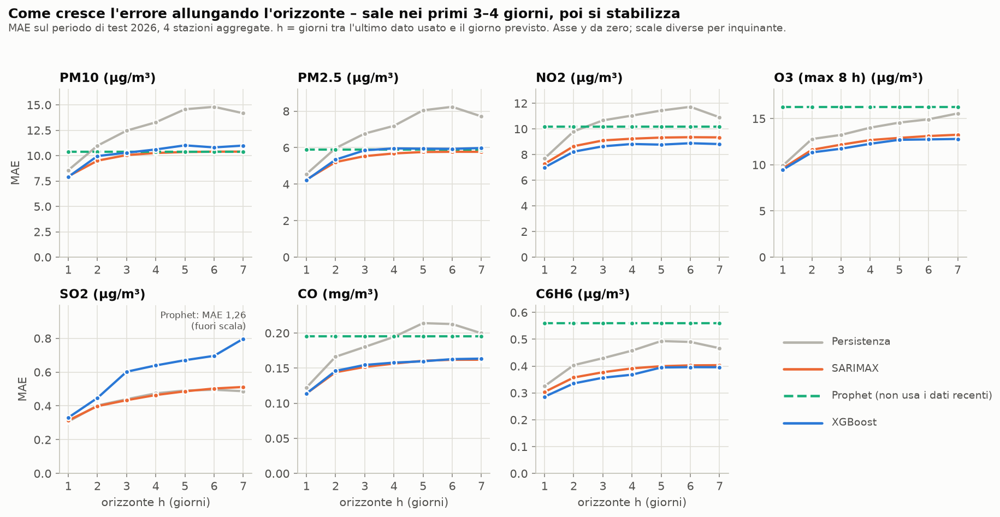

*Figura 15 – MAE sul periodo di test 2026 (4 stazioni aggregate) in funzione dell'orizzonte, per persistenza, SARIMAX, Prophet (tratteggiato) e XGBoost. ARIMA e Prophet + lag sono nelle tabelle di [forecast_results.md](forecast_results.md).*

| Inquinante | MAE persistenza *h*=1 | MAE persistenza *h*=7 | Miglior modello a *h*=7 | MAE | Skill a *h*=7 | MAE Prophet |
|---|---:|---:|---|---:|---:|---:|
| PM10 (µg/m³) | 8,57 | 14,18 | Prophet / SARIMAX | 10,37 / 10,40 | +26,8 / +26,7 % | 10,37 |
| PM2.5 (µg/m³) | 4,55 | 7,71 | ARIMA | 5,70 | +26,1 % | 5,90 |
| NO2 (µg/m³) | 7,70 | 10,91 | XGBoost | 8,82 | +19,2 % | 10,17 |
| O3 (µg/m³) | 9,90 | 15,56 | XGBoost | 12,80 | +17,8 % | 16,27 |
| SO2 (µg/m³) | 0,31 | 0,49 | Persistenza | 0,49 | – | 1,26 |
| CO (mg/m³) | 0,122 | 0,200 | SARIMAX | 0,162 | +18,9 % | 0,195 |
| Benzene (µg/m³) | 0,33 | 0,47 | ARIMA | 0,36 | +23,1 % | 0,56 |

Cosa si vede:

- **L'errore cresce soprattutto nei primi 2–3 giorni, poi si stabilizza.** Per il PM10 il MAE di SARIMAX passa da 7,97 a 10,06 a *h* = 3 e arriva a 10,40 a *h* = 7: l'86 % dell'aumento avviene entro il terzo giorno. Per PM2.5 e NO2 il quadro è lo stesso (88–90 %). L'O3 fa eccezione: il MAE continua a crescere fino al settimo giorno (XGBoost: 9,46 → 11,74 → 12,80).
- **La persistenza invece peggiora molto di più.** Per il PM10 il suo MAE cresce del 65 % (da 8,57 a 14,18), quello di SARIMAX del 30 %. Per questo la skill dei modelli **cresce** con l'orizzonte: dal +6/8 % a un giorno al +22/27 % a sette giorni. Non significa che i modelli migliorino. Significa che "fra una settimana = oggi" è una pessima previsione.
- **Per PM10 e PM2.5, dopo 3–4 giorni i modelli non fanno meglio della stagionalità.** Da *h* = 4 in poi ARIMA, SARIMAX e XGBoost hanno un errore entro il 5 % di quello di Prophet standard, che non usa alcun dato recente. A *h* = 7 per il PM10 il migliore è proprio Prophet (10,37), con SARIMAX praticamente pari (10,40). In pratica, a una settimana dai dati recenti non si ricava quasi più nulla sul particolato. Resta la media stagionale della stazione.
- **Per NO2, O3, CO e benzene i dati recenti servono anche a sette giorni.** A *h* = 7 il miglior modello ha un MAE più basso di Prophet:

  | Inquinante | MAE più basso di Prophet |
  |---|---:|
  | NO2 | 13 % |
  | CO | 17 % |
  | O3 | 21 % |
  | Benzene | 36 % |

  Il motivo è che Prophet sbaglia il *livello* di questi inquinanti nel 2026: c'è il calo dell'NO2 a Napoli e l'estrapolazione della curva annuale per O3 e benzene (§11.2). I modelli che conoscono la media degli ultimi 30 giorni si correggono. XGBoost lo dice esplicitamente: a *h* = 7 la feature più importante è la media a 30 giorni (`y_roll30`) per 5 inquinanti su 7 (per l'NO2 è seconda, dopo la stazione), seguita da stazione e calendario. Il valore "di ieri", che dominava a un giorno, scompare. A una settimana conta **il livello recente più la stagione**, non la dinamica del giorno prima.
- **SARIMAX non ripaga a orizzonti lunghi.** Ci si poteva aspettare che la componente stagionale e il calendario di SARIMAX facessero la differenza a più giorni (§6). Non è così: a *h* = 7 SARIMAX e ARIMA sono quasi uguali per PM10 (10,40 contro 10,43), PM2.5 e O3. SARIMAX è un po' meglio per il CO (0,162 contro 0,169) ed è peggio per il benzene. Un ciclo settimanale debole e una stagionalità annuale lenta non bastano a spostare l'errore.
- **SO2: la persistenza resta il miglior modello a ogni orizzonte.** SARIMAX la eguaglia (entro ±5 %), mentre ARIMA e XGBoost peggiorano rapidamente: a *h* = 7 XGBoost ha un MAE di 0,80 contro 0,49. Con serie a gradini (§11.2), l'ultimo livello osservato è la stima migliore anche una settimana dopo.

### 12.3 Cosa succede alla previsione

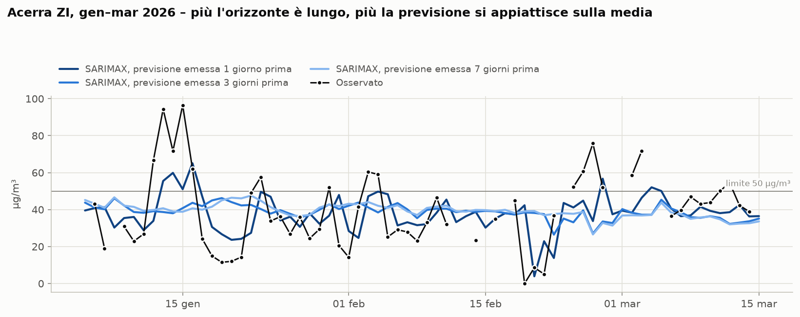

*Figura 16 – PM10 ad Acerra, gennaio–marzo 2026. Osservato (punti neri) e previsione SARIMAX emessa 1 giorno (blu scuro), 3 giorni (blu) e 7 giorni prima (azzurro).*

La previsione a un giorno insegue le osservazioni con il ritardo di un giorno già visto nel §9. Quelle a 3 e 7 giorni sono quasi sovrapposte tra loro e quasi piatte, intorno a 35–45 µg/m³, cioè il livello invernale tipico di Acerra. L'episodio di metà gennaio (oltre 90 µg/m³) e quello di fine febbraio **non lasciano traccia** nelle previsioni a più giorni. Anche il crollo di metà febbraio (sotto 10 µg/m³) passa inosservato. È la stessa regression to the mean del §10, ma molto più forte: senza informazioni sul meteo dei giorni futuri, l'unica previsione "sicura" a una settimana è la media.

### 12.4 I superamenti con anticipo

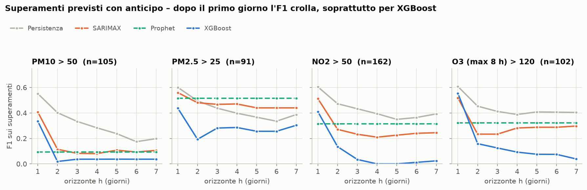

*Figura 17 – F1 sui superamenti in funzione dell'orizzonte, per i quattro inquinanti con superamenti nel test (4 stazioni aggregate).*

Già a un giorno i modelli intercettano pochi superamenti (§10). A più giorni la situazione peggiora rapidamente:

- **XGBoost e ARIMA quasi non prevedono più superamenti dopo il primo giorno.** Per PM10 e NO2 l'F1 di XGBoost scende sotto 0,05 da *h* = 2 o 3 in poi. Quello di ARIMA è già vicino a zero da *h* = 2 per il PM10, e scende fino a 0,01 a *h* = 7 per l'NO2. Prevedere sempre vicino alla media minimizza l'errore assoluto, ma porta a non superare mai la soglia.
- **PM10, NO2, O3: le baseline naive restano le migliori a ogni orizzonte.** Vince la persistenza o, in alcuni giorni, il seasonal naive. Anche le baseline però perdono valore: per il PM10 l'F1 della persistenza scende da 0,55 a 0,20 in una settimana.
- **PM2.5 fa eccezione.** Prophet (0,51) e Prophet + lag (0,49–0,53) battono la persistenza da *h* = 2, SARIMAX (0,44–0,47) da *h* = 3. La persistenza scende a 0,34–0,49. I superamenti di PM2.5 a 25 µg/m³ sono concentrati nei mesi invernali, e una previsione stagionale che sta sopra la soglia per tutto l'inverno ne intercetta una buona parte. È un'"allerta di stagione", non di episodio.

**Un'allerta di superamento con qualche giorno di anticipo non si può costruire con questi dati.** Servono le previsioni meteo (§13, passo 1 dei prossimi passi).

### 12.5 La previsione per il 27 ottobre – 2 novembre 2026

La previsione è emessa con i dati fino al **26 ottobre 2026**, l'ultimo giorno del dataset. Per ogni inquinante si usa il modello con il MAE medio più basso sui 7 orizzonti nel periodo di test:

| Inquinante | Modello |
|---|---|
| PM10 | SARIMAX |
| PM2.5 | ARIMA |
| NO2 | XGBoost |
| O3 | XGBoost |
| SO2 | Persistenza |
| CO | SARIMAX |
| Benzene | ARIMA |

L'**intervallo all'80 %** è empirico. Per ogni orizzonte si prendono il 10° e il 90° percentile degli errori che quel modello ha commesso nel 2026 (in scala logaritmica, 4 stazioni insieme) e si applicano alla previsione. L'intervallo è quindi più largo a *h* = 7 che a *h* = 1, e asimmetrico verso l'alto.

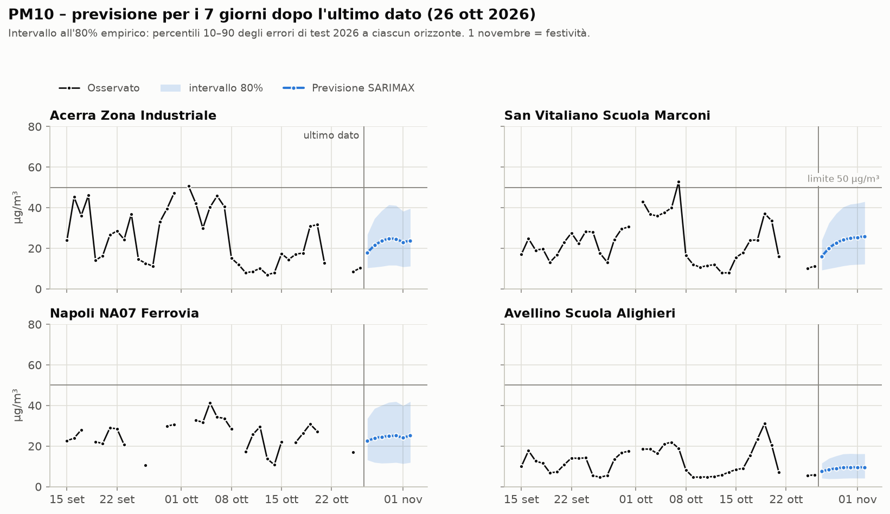

*Figura 18 – PM10, ultime sei settimane osservate (nero) e previsione SARIMAX per i 7 giorni successivi (blu) con intervallo all'80 % (banda azzurra).*

| PM10 (µg/m³) | Acerra ZI | San Vitaliano | Napoli Ferrovia | Avellino |
|---|---:|---:|---:|---:|
| ultimo dato | 10 (26/10) | 11 (26/10) | 17 (25/10) | 6 (26/10) |
| mar 27 ott | 18 (10–27) | 16 (9–24) | 23 (13–34) | 8 (4–12) |
| mer 28 ott | 21 (11–35) | 20 (10–32) | 24 (12–39) | 8 (4–14) |
| gio 29 ott | 24 (11–39) | 23 (11–37) | 25 (12–40) | 9 (4–15) |
| ven 30 ott | 25 (12–41) | 24 (11–40) | 25 (12–42) | 9 (4–16) |
| sab 31 ott | 25 (12–41) | 25 (12–42) | 25 (12–42) | 10 (4–16) |
| dom 1 nov | 23 (11–38) | 25 (12–42) | 24 (11–40) | 10 (4–16) |
| lun 2 nov | 24 (11–40) | 26 (12–43) | 25 (12–42) | 10 (4–16) |

**PM10.** Il 25–26 ottobre i valori erano bassi (6–17 µg/m³). La previsione risale in 3–4 giorni verso il livello tipico di fine ottobre: circa 25 µg/m³ nelle tre stazioni dell'area napoletana e circa 10 ad Avellino. Nessun superamento è previsto. Anche l'estremo superiore dell'intervallo (40–43 µg/m³) resta sotto 50. La risalita verso la media è quella vista nel §12.3: il modello non "sa" se l'aria pulita durerà, quindi torna verso il valore stagionale. Il 1° novembre (festivo) c'è un piccolo calo ad Acerra.

**Gli altri inquinanti.** Le tabelle complete sono in [forecast_results.md](forecast_results.md).

| Inquinante | Previsione | Soglia |
|---|---|---|
| NO2 | Napoli Ferrovia 42–49 µg/m³ (intervallo fino a 71); Acerra 35–42 | 50: superamento possibile in entrambe |
| PM2.5 | Napoli 15 µg/m³; altre stazioni 6–11 | 25: sotto |
| O3 | 61–77 µg/m³ | 120: molto sotto (autunno) |
| SO2, CO, benzene | Valori bassi e stabili | – |

**Verifica.** Al momento della stesura questi sette giorni sono già passati, ma i dati validati non sono ancora nel dataset. Il confronto con le osservazioni sarà il primo controllo da fare quando arriveranno.

---

## 13. Conclusioni e prossimi passi

### Cosa abbiamo imparato

- **La scelta dell'algoritmo conta meno dell'informazione disponibile.** Per il PM10, ARIMA, SARIMAX, Prophet + lag e XGBoost raggiungono quasi la stessa accuratezza (MAE circa 8 µg/m³) e battono "domani = oggi" solo del 6–8 %. Per gli altri inquinanti il guadagno è tra il 5 e il 12 %, e di nuovo i modelli migliori sono vicini tra loro.
- **La persistenza è il segnale dominante** per il giorno dopo, per tutti gli inquinanti. Un modello che ignora i valori recenti, come Prophet standard, a un giorno è sempre peggiore della persistenza. A più giorni la persistenza perde valore: per PM10, PM2.5 e NO2 Prophet la supera già da 2–3 giorni di anticipo (§12).
- **La stagionalità e il ciclo settimanale sono reali ma secondari** a un orizzonte di 1 giorno. Il ciclo settimanale conta un po' di più per gli inquinanti da traffico (NO2, benzene).
- **Così come sono, i modelli non sono adatti alle allerte per superamento.** Hanno una buona precision ma mancano da metà a tre quarti dei superamenti, e per ogni inquinante la persistenza ha un F1 migliore.
- **A più giorni l'errore cresce soprattutto nei primi 2–3 giorni, poi si stabilizza** (§12). La skill vs persistenza aumenta (+15/+27 % a sette giorni), ma solo perché la persistenza peggiora molto più in fretta. Per PM10 e PM2.5, oltre il terzo-quarto giorno i modelli non battono più la sola stagionalità di Prophet. Per NO2, O3, CO e benzene invece il livello recente (media a 30 giorni) resta utile anche a una settimana.
- **Le allerte con qualche giorno di anticipo non sono possibili con questi dati.** Dopo il primo giorno l'F1 sui superamenti crolla, soprattutto per XGBoost e ARIMA, che prevedono valori sempre vicini alla media. L'unica eccezione parziale è il PM2.5, i cui superamenti invernali sono in buona parte stagionali.
- **Dove la previsione ha senso pratico**: PM10, PM2.5, NO2 e O3, che hanno superamenti frequenti. Per SO2 e CO, con valori molto sotto i limiti, e per il benzene, che ha solo un limite annuale, la previsione giornaliera ha poca utilità operativa.

### Prossimi passi consigliati (per impatto atteso)

| # | Passo | Effetto atteso |
|---|---|---|
| 1 | **Aggiungere dati meteo** (velocità del vento, altezza dello strato limite, pioggia, temperatura, umidità, radiazione solare) da Open-Meteo o ERA5. Usare i valori osservati per il training e i valori previsti in esercizio | Il miglioramento più grande disponibile; aiuta a intercettare gli episodi prima che inizino. Per l'O3 temperatura e radiazione sono essenziali. È l'unico modo per rendere utile la previsione oltre i 2–3 giorni (§12): le previsioni meteo a una settimana contengono l'informazione che i dati di qualità dell'aria non hanno |
| 2 | **Aggiungere le previsioni di polveri sahariane** (Copernicus CAMS) | Mira ai principali episodi primaverili ed estivi di PM10 e PM2.5 |
| 3 | **Correggere le previsioni basse nei giorni alti**: riconvertire con `exp(m + σ²/2)`, abbassare la soglia di allerta (es. allerta sopra 42 per il PM10), oppure addestrare XGBoost direttamente come classificatore "superamento domani" | Recall più alta sui superamenti, al prezzo di più falsi allarmi (una scelta da fare con gli utenti della previsione) |
| 4 | **Ridurre la flessibilità annuale di Prophet** (es. `yearly_seasonality=4`) e limitarne il trend | Meno overfitting degli episodi isolati e meno estrapolazioni sbagliate (O3, SO2, benzene) |
| 5 | **Valutazione rolling** (ristima ogni mese) e più tuning di XGBoost | Confronto più affidabile; aiuta anche con i cambi di livello tra un anno e l'altro |
| 6 | **Verificare la qualità delle serie di SO2** (cambi di livello, valori vicini al limite di rilevabilità) prima di qualunque uso modellistico | Capire se i gradini sono reali o strumentali |

---

## 14. Come riprodurre i risultati

Tutti i comandi vanno eseguiti dalla cartella `4_FORECASTING/` (il CSV grezzo va in `../data/raw/`). `uv` crea un ambiente temporaneo Python 3.12 con i pacchetti necessari. Python 3.14 non è ancora supportato da Prophet.

```bash
# tutte e tre le fasi in sequenza (~5 min su 20 core)
uv run --python 3.12 --with pandas --with pyarrow --with statsmodels --with prophet --with xgboost \
       --with scikit-learn --with tabulate --with matplotlib python codice/air_quality_forecast.py

# oppure una fase alla volta:
#   prep      pulisce il CSV orario e calcola le medie giornaliere e l'O3 MDA8 -> cache/daily_panel.parquet (~1 min)
#   forecast  stima e valuta tutti i modelli -> forecast_results.md + cache/*.parquet; le 28 serie
#             (inquinante x stazione) e i 49 modelli XGBoost (inquinante x orizzonte) sono stimati in parallelo
#   plots     disegna i grafici -> figures/*.png
uv run ... python codice/air_quality_forecast.py prep
uv run ... python codice/air_quality_forecast.py forecast --pollutants PM10 NO2   # solo alcuni inquinanti
uv run ... python codice/air_quality_forecast.py plots
```

| File | Contenuto |
|---|---|
| `cache/daily_panel.parquet` | Medie giornaliere per stazione e inquinante (≥ 18 ore valide) e O3 MDA8 |
| `cache/forecast_predictions.parquet` | La previsione a un giorno di ogni modello, per inquinante e stazione, nel 2026 |
| `cache/forecast_predictions_h.parquet` | Come sopra, per ogni orizzonte da 1 a 7 giorni (colonna `h`) |
| `cache/forecast_next7.parquet` | Previsione per i 7 giorni dopo l'ultimo dato: tutti i modelli, modello scelto e intervallo all'80 % |
| `cache/xgb_feature_importance.csv` | Feature importance dei modelli XGBoost, per inquinante e orizzonte |
| `cache/prophet_components.parquet` | Componenti trend / stagionali / festività di Prophet, per inquinante e stazione |
| `forecast_results.md` | Tabelle complete delle metriche per inquinante e stazione, modelli selezionati, feature importance, errore per orizzonte, previsione per i 7 giorni dopo l'ultimo dato |
| `figures/` | I 18 grafici usati in questo documento (01–10: PM10; 11–14: confronto tra inquinanti; 15–18: orizzonte da 1 a 7 giorni) |
